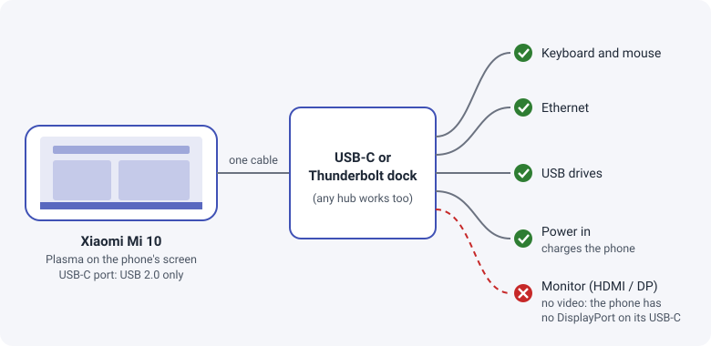

---
hide:
  - navigation
---

# Arch Linux ARM on the Xiaomi Mi 10

<p class="hero-lead">
A full Arch Linux ARM system with the KDE Plasma desktop for the Xiaomi Mi 10
(<code>umi</code>, Snapdragon 865). Plug the phone into a USB-C dock or hub and
you get a small Linux desktop: keyboard, mouse and Ethernet on the dock, Plasma
on the phone's own screen, and <code>pacman</code> for everything else.
</p>

[Install it](install.md){ .md-button .md-button--primary }
[Download the latest release](https://github.com/miercolesvd/mi10-arch-linux/releases/latest){ .md-button }

{ .diagram }

## What you get

<div class="grid cards" markdown>

-   :material-monitor-dashboard:{ .lg .middle } **A real desktop**

    ---

    KDE Plasma on Wayland, Firefox, Konsole, Dolphin and Kate. Landscape at
    150 % scaling from the first login, with Plasma's on-screen keyboard for
    touch.

-   :material-usb-port:{ .lg .middle } **Docks and hubs**

    ---

    The USB-C port switches to host mode: keyboards, mice, USB drives and
    Ethernet adapters work, and a powered dock charges the phone.

-   :material-package-variant-closed:{ .lg .middle } **Plain Arch Linux ARM**

    ---

    Arch Linux ARM's own packages, plus a small `mi10` repository for the
    kernel and device support. `sudo pacman -Syu` updates both and rewrites the
    boot partition by itself.

-   :material-chip:{ .lg .middle } **Close to mainline**

    ---

    A 6.12 LTS kernel with 16 patches for this phone. Sound, Wi-Fi,
    Bluetooth, the GPU and mobile data come from the
    [Nura port](https://github.com/miercolesvd/mi10-port) of the same kernel.

</div>

## Status

Confirmed on this Arch build (25 Nov 2026): it boots to Plasma, the screen
and touch work, and a Thunderbolt 4 dock gives keyboard, mouse and Ethernet.
The rest of the hardware support is the Nura port's, which uses the same
kernel. See [Hardware status](hardware.md) for every component.

!!! warning "Known limits"

    - **No external monitor.** The Mi 10's USB-C port only carries USB 2.0,
      so a dock's HDMI or DisplayPort output stays dark. No software can
      change that.
    - **Only the CSOT panel with ST FTS touch** is supported. Phones with the
      Samsung panel or Goodix touch need different panel data.
    - **Installing erases the phone's user data** (Android or any other
      system on `userdata`).

## Quick start

For people who have done this before. Everyone else: read
[Install](install.md) first.

```sh
cat mi10-arch.img.zst.part* | zstd -d -o mi10-arch.img
sha256sum -c SHA256SUMS
fastboot flash userdata mi10-arch.img
fastboot flash boot boot.img
fastboot boot boot.img
```

Log in as `user`, password `147147`, and change it with `passwd`.
