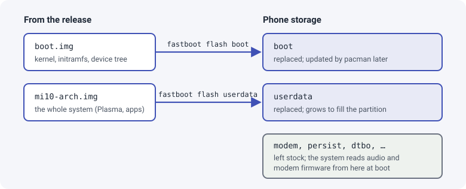

# Install

Installing replaces two partitions on the phone: `boot` gets the kernel and
`userdata` gets the whole system. Everything else, including the phone's
firmware, stays as it is.

{ .diagram }

## Before you start

- [x] **Bootloader unlocked.** Xiaomi's unlock tool needs a Mi account and
      makes you wait a few days after the first request.
- [x] **A computer with `fastboot`** (Android platform-tools) and `zstd`.
- [x] **A backup.** Flashing `userdata` erases everything on it: Android's
      apps, photos and files, or a Nura install.
- [x] **The supported variant:** CSOT panel with ST FTS touch. Other panel
      or touch variants won't work with this kernel.

!!! danger "This erases the phone's user data"

    There is no undo. Copy off anything you want to keep before step 3.

## 1. Download

Open the [latest release](https://github.com/miercolesvd/mi10-arch-linux/releases/latest)
and download every file:

| File | What it is |
|---|---|
| `boot.img` | kernel, initramfs and device tree, for the `boot` partition |
| `mi10-arch.img.zst.part*` | the system image, compressed and split (GitHub limits files to 2 GiB) |
| `SHA256SUMS` | checksums of `boot.img` and the uncompressed system image |
| `packages.txt` | every package in the image, with versions |

## 2. Put the system image together

Join the parts, decompress, and check both images.

=== "Linux"

    ```sh
    cat mi10-arch.img.zst.part* | zstd -d -o mi10-arch.img
    sha256sum -c SHA256SUMS
    ```

=== "macOS"

    ```sh
    cat mi10-arch.img.zst.part* | zstd -d -o mi10-arch.img
    shasum -a 256 -c SHA256SUMS
    ```

=== "Windows"

    ```bat
    copy /b mi10-arch.img.zst.part* mi10-arch.img.zst
    zstd -d mi10-arch.img.zst -o mi10-arch.img
    certutil -hashfile boot.img SHA256
    certutil -hashfile mi10-arch.img SHA256
    ```

    Compare the two hashes with the ones in `SHA256SUMS`.

Both lines must say `OK`. If not, download the files again.

## 3. Flash

Turn the phone off. Hold ++volume-down++ and ++power++ until **FASTBOOT**
appears, then connect it to the computer.

```sh
fastboot devices                        # the phone must be listed
fastboot flash userdata mi10-arch.img   # a few minutes; keep the cable in
fastboot flash boot boot.img
fastboot boot boot.img                  # start it this once
```

!!! note "Why `fastboot boot` and not `fastboot reboot`"

    Straight after flashing, `fastboot reboot` drops back into fastboot
    instead of starting the new system. Start it once with
    `fastboot boot boot.img`; after that, ordinary restarts boot Arch.

## 4. First boot

The first boot takes a little longer while the file system grows to fill the
whole partition. Plasma then starts by itself, already logged in, in
landscape at 150 % scaling.

No keyboard yet? Tap any text field and Plasma's on-screen keyboard appears.

## 5. Accounts and passwords

| Account | Password | Notes |
|---|---|---|
| `user` | `147147` | Logs in automatically. Use it for `sudo` and for every "Authentication required" window. |
| `root` | none | Locked. Use `sudo -i` for a root shell. |

**Change the password right away.** Open Konsole and run:

```sh
passwd
```

If you really want a root password: `sudo passwd root`.

!!! tip "sudo refuses the right password?"

    After 3 wrong passwords in a row, Arch locks the account for
    **10 minutes**, and during that time even the correct password fails.
    Wait, then type it once. If you type the password on the numeric keypad,
    turn Num Lock on: the password stays hidden, so you can't see the keypad
    typing nothing.

## Going back

- **To Android:** flash a stock fastboot ROM for the Mi 10 with Xiaomi's
  flash tool. That restores every partition, including `boot` and
  `userdata`.
- **To Nura:** flash the Nura port's images the same way as above.
