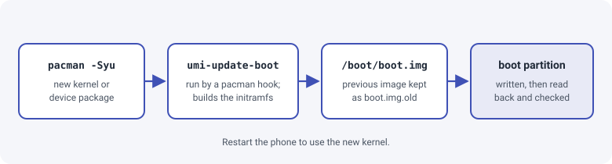

# Updates

```sh
sudo pacman -Syu
```

That updates everything: Arch Linux ARM's packages, and the Mi 10's own
packages (kernel, firmware, device support) from this project's `mi10`
repository. Each build publishes that repository as the
[`packages` release](https://github.com/miercolesvd/mi10-arch-linux/releases/tag/packages).

## Installs from build-6

Images up to build-6 don't know the `mi10` repository yet, so `pacman -Syu`
only updates Arch's packages. Add it once:

```sh
sudo tee -a /etc/pacman.conf <<'EOF'

[mi10]
SigLevel = Optional TrustAll
Server = https://github.com/miercolesvd/mi10-arch-linux/releases/download/packages
EOF
sudo pacman -Syu
```

The `mi10` packages aren't signed; pacman downloads them over HTTPS from
GitHub.

## How kernel updates reach the phone

The phone's bootloader only starts what is in the `boot` partition, so a new
kernel has to be written there. That happens by itself:

{ .diagram }

`umi-update-boot` runs after every update of the kernel, firmware, initramfs
tools or the device package. It:

1. rebuilds the initramfs with `mkinitcpio`,
2. packs kernel, initramfs and device tree into `/boot/boot.img`, keeping the
   previous image as `/boot/boot.img.old`,
3. writes the image to the `boot` partition and reads it back to check it.

Restart the phone to use the new kernel.

To run it by hand, for example after changing the kernel command line in
`/etc/kernel/cmdline`:

```sh
sudo umi-update-boot
```

## If the phone doesn't start after an update

Nothing is lost: the system on `userdata` is untouched.

1. Hold ++volume-down++ and ++power++ to get into fastboot.
2. Start a boot image that worked, without flashing it:
    ```sh
    fastboot boot boot.img
    ```
    Use `boot.img` from an earlier [release](https://github.com/miercolesvd/mi10-arch-linux/releases),
    or the phone's own `/boot/boot.img.old` if you copied it off.
3. Once the phone is up, put that image back on `boot` and report the
   problem:
    ```sh
    sudo dd if=/boot/boot.img.old of=/dev/disk/by-partlabel/boot bs=4M conv=fsync
    ```
