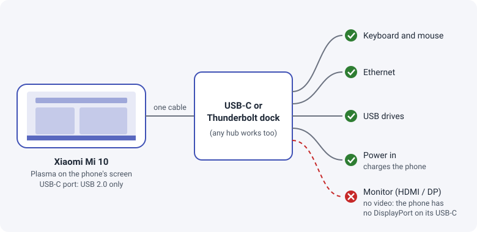

# Using it

## The desktop

Plasma runs on Wayland on the phone's 6.67" screen. On the first login it
turns the screen to landscape (90° counterclockwise) at 150 % scaling. To
change either, open **System Settings → Display & Monitor**.

!!! info "Images up to build-6"

    The first images started in portrait at 100 %. Set it once in Display &
    Monitor: the **fourth** Orientation button (90° counterclockwise) and
    Scale 150 %. An update to the current `umi-device` package does it for
    you on the next login (see [Updates](updates.md)).

Without a keyboard, tap a text field to bring up Plasma's on-screen keyboard.

## On a dock

{ .diagram }

Plug the phone into any USB-C hub or dock, including Thunderbolt 3 and 4
docks.

- **Keyboard, mouse, USB drives and Ethernet** work. They show up like on
  any Linux PC; Ethernet connects through NetworkManager by itself.
- **Charging:** a dock with its own power supply charges the phone.
  An unpowered hub gets its power from the phone instead.
- **Speed:** everything shares one USB 2.0 link (480 Mbit/s), so Ethernet
  and USB drives stay well below their usual speed.
- **Monitor:** the dock's HDMI and DisplayPort outputs stay dark. The Mi 10
  wires only USB 2.0 to its USB-C port, so there is no video signal for the
  dock to pass on.

## From a PC over USB

Plugged straight into a computer (not through a dock), the phone shows up as
a USB network adapter. The phone is `172.16.42.1`, and the computer gets an
address automatically:

```sh
ssh user@172.16.42.1
```

SSH only listens on that USB link, not on Wi-Fi or Ethernet (see below to
change that).

!!! note

    The USB link is new in the Arch build and hasn't been tried on a phone
    yet. If it doesn't show up, see [Troubleshooting](troubleshooting.md).

## SSH over Wi-Fi or Ethernet

Change the default password first (`passwd`): anyone on the same network
could otherwise log in with `147147`. Then:

```sh
sudo sed -i 's/^ListenAddress/#ListenAddress/' /etc/ssh/sshd_config.d/50-umi-usb.conf
sudo systemctl restart sshd
ip -4 -br addr        # the phone's address, on wlan0 (Wi-Fi) or the dock's Ethernet
```

From the computer: `ssh user@<that address>`.

Edit the file rather than deleting it: a deleted file comes back with the next
`umi-device` update, an edited one stays as you left it.

Logging in with a key is safer than a password:

```sh
ssh-copy-id user@<address>      # on the computer, once
```

After that, you can turn password logins off on the phone:

```sh
echo 'PasswordAuthentication no' | sudo tee /etc/ssh/sshd_config.d/60-keys-only.conf
sudo systemctl restart sshd
```

## Networks

- **Wi-Fi and Bluetooth:** Plasma's network and Bluetooth icons in the panel,
  as on any Plasma desktop.
- **Mobile data (4G/5G):** with a SIM card, the modem starts at boot and
  mobile data comes up by itself when no other connection is active. It runs
  outside NetworkManager, so Plasma doesn't show it. Calls and SMS are not set
  up.

## Sound

Both loudspeakers play in stereo and the internal microphones work, through
PipeWire. Wired headsets (USB-C audio adapters) and the earpiece for calls
don't work yet.

## Battery

The phone charges from a charger or a powered dock.

!!! bug "Shows "Discharging" while charging"

    The battery status can say *Discharging* even though the charge level
    goes up. It's a reporting bug in the charger driver and is being looked
    into; charging itself works.

## Suspend

Suspend has never been tried on this port, so it's switched off: the phone
can't go to sleep in a state it might not wake from. To try it anyway:

```sh
sudo systemctl unmask sleep.target suspend.target
```

## Installing software

It's Arch Linux ARM: `sudo pacman -S <package>`. Packages have to be built
for `aarch64`; most of the Arch repositories are. Flatpak works too after
`sudo pacman -S flatpak`.

To see which kernel and device packages you have:

```sh
pacman -Q linux-xiaomi-umi umi-device umi-firmware
```
